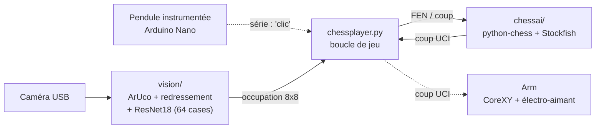

# ar4-chessplayer
Une joueur d'échecs robotique à partir d'un plateau CoreXY avec aimant et vision par camera

## Architecture

Le projet est découpé en quatre sous-systèmes logiciels orchestrés par `chessplayer.py`, et un sous-système mécanique (plateau CoreXY à électro-aimant).

*Traits pleins : implémenté. Pointillés : prévu (sidequests).*

### Boucle principale – `chessplayer.py`

- Arguments : `--color blancs|noirs` (couleur jouée par la machine, noirs par défaut), `--debug-vision`, `--test <image>` (teste la détection sur une photo, sans caméra).
- Boucle tour par tour :
  1. **Tour IA** : Stockfish propose un coup, affiché par une flèche dans la fenêtre Tkinter. Tant que le bras n'est pas opérationnel, l'humain joue ce coup à la place du robot.
  2. **Tour humain** : l'humain joue sur le plateau physique.
  3. Validation du coup au clavier (`a` pour abandonner) ; à terme, ce sera le clic de la pendule via le port série (`wait_for_click`, code présent mais commenté).
  4. Photo du plateau → occupation des 64 cases → déduction du coup par comparaison avec la FEN précédente → mise à jour de la partie.

### Vision – `vision/`

| Étape | Fonction | Détail |
|---|---|---|
| Capture | `get_board()` | Webcam (`VideoCapture(0)`) ou image de test |
| Localisation | `detect_aruco()`, `get_board_corners_from_tags()` | 4 tags ArUco `DICT_4X4_50` de 3 cm aux coins : id 19 (sous A1), 29 (sous H1), 39 (à droite de H8), 9 (à gauche de A8). Images dans `vision/ressources/` |
| Redressement | `warp_board()` | Transformation perspective vers une image 800 × 800 px |
| Découpage | `slice_into_64_cases()` | 64 vignettes de 100 × 100 px, indexées `a1`…`h8` |
| Classification | `predict_board_occupancy()` | ResNet18 (PyTorch, `model_chess.pth`), 3 classes : `piece_blanche`, `piece_noire`, `vide` |
| Déduction du coup | `detect_move_from_occupancy()` | Compare l'occupation avant (issue de la FEN) et après ; gère les roques, les prises et la promotion (dame par défaut) |

Entraînement et données :
- `get_dataset.py` : capture automatique d'images étiquetées à partir de la position initiale.
- `vision/train_pytorch_model.py` : fine-tuning d'un ResNet18 pré-entraîné ImageNet (images 128 px, augmentation, early stopping) → `model_chess.pth`.
- `vision/dataset_train.py`, `dataset_train_v2.py` et les modèles `.keras` : premières versions sous TensorFlow/Keras (CNN maison, puis transfer learning), conservées pour mémoire. La chaîne actuelle utilise uniquement le modèle PyTorch.

### Moteur d'échecs – `chessai/chessmonitor.py`

Classe `Chessfish` :
- Tient l'état de la partie (`python-chess`, à partir de la FEN de départ).
- `get_ai_move()` : meilleur coup Stockfish (profondeur 15).
- `play_move()` : vérifie la légalité du coup et l'applique.
- Affichage de l'échiquier dans une fenêtre Tkinter (SVG converti par `cairosvg`, avec repli en ASCII dans la console).

### Pendule – *sidequest*

Pendule d'échecs instrumentée par un Arduino Nano, qui envoie `clic` sur le port série (9600 bauds) quand un joueur appuie. Le code côté PC est prêt (`wait_for_click`) ; le firmware n'est pas encore dans le dépôt.

### Bras (Arm) – *sidequest*

Reçoit un coup UCI et déplace la pièce par un électro-aimant sous le plateau. Pas encore de code dans le dépôt. La mécanique est décrite ci-dessous.

## Mécanique – `mecanique/`

### Châssis
- Caisson de 600 × 600 × 100 mm, ossature en profilés aluminium **MakerBeam 10 × 10 mm** (structure en H / portique).
- Plateau supérieur en plexiglas de 4 à 5 mm, qui porte l'échiquier taille 5 (400 × 400 mm, cases de 50 mm). Il est centré, avec une marge de 100 mm sur le pourtour pour les moteurs et les poulies.
- Plaque de fond rigide (MDF ou contreplaqué), qui raidit l'ensemble et porte les moteurs.

### Guidage linéaire
- 3 rails **MGN9H** (9 mm, quasiment au ras des profilés de 10 mm).
- **Axe Y** : 2 rails parallèles sur les profilés latéraux inférieurs, un chariot chacun.
- **Axe X** : 1 rail sur un profilé MakerBeam monté en pont entre les deux chariots Y via des *gantry blocks* imprimés en 3D. Il porte le chariot central.

### Cinématique et transmission – CoreXY
- Deux boucles de courroie indépendantes. Les moteurs restent fixes à l'arrière, ce qui allège l'axe X mobile et évite de faire fléchir les profilés de 10 mm.
- 2 moteurs **NEMA 17** Motech MT-1704HS168A (1,8°/pas, 1,68 A, axe 5 mm).
- Courroies **2GT renforcées fibre de verre, 9 mm** (Trianglelab).
- 10 poulies : 2 motrices de 20 dents (alésage 5 mm) et 8 folles de 9-10 mm, montées par paires (4 dans les coins avant, 4 sur les chariots Y).
- Croisements : les deux boucles circulent sur deux étages décalés d'environ 11-12 mm. Les supports de poulies sont en « sandwich » (tenus en haut et en bas) pour encaisser la tension de la courroie de 9 mm.

### Préhenseur
- **Électro-aimant fixe** 24 V (maintien de 25 à 50 N, Ø 20-25 mm) monté sur le chariot central. Pas d'axe Z, pour garder une masse mobile minimale.
- Anti-collision : les pièces se déplacent le long des lignes entre les cases plutôt qu'en diagonale directe.
- Commande PWM : 100 % pour saisir la pièce, environ 50 % pendant le déplacement (champ magnétique plus étroit, moins de chauffe).
- Magnétisme résiduel : fine couche de téflon ou de feutrine sur l'aimant, et réglage précis de sa hauteur sous le plexiglas.

### Nomenclature

| Sous-ensemble | Composant | Spécification |
|---|---|---|
| Châssis | MakerBeam 10 × 10 | Cadre 600 × 600 × 100 mm |
| Guidage | Rails + chariots | 3 × MGN9H (2 sur Y, 1 sur X) |
| Actionneurs | Moteurs X/Y | 2 × NEMA 17 (axe 5 mm, 1,8°) |
| Transmission | Courroies et poulies | 2GT 9 mm + 2 motrices + 8 folles |
| Préhension | Électro-aimant | 24 V, Ø 20-25 mm, fixe sur le chariot X |
| Pièces imprimées 3D | Supports sur mesure | Blocs moteurs, coins sandwich, gantry blocks, support d'aimant |

Fichiers CAO dans le dépôt (FreeCAD `.FCStd`, et `.stp` pour les profilés) : `caisson`, `Joint_rail`, `equerre_rail`, `pieces/rail`, `pieces/Chariot`, `pieces/makerbeam_100`, `makerbeam_600`, `makerbeam_corner`. L'assemblage complet est modélisé sur Onshape.

## État d'avancement

- [x] Détection du plateau par ArUco et classification des 64 cases
- [x] Déduction du coup joué et suivi de la partie avec Stockfish
- [x] Mode test sur image
- [ ] Validation du coup par la pendule (code PC prêt, firmware Arduino à ajouter)
- [ ] Pilotage du CoreXY et de l'électro-aimant (module Arm)
- [ ] Fichier `requirements.txt` et chemin Stockfish configurable

## Matériel

* Plateau d'échecs : https://damieropera.com/produit/echiquier-en-vinyle-souple-roulable-4/ (vert)
* Pièces : https://damieropera.com/produit/pieces-en-resine-plombees-taille-5-3/
* Horloge : https://www.amazon.fr/RNPKZ-Professionnelle-chronomètre-pourMaison-etTournois/dp/B0FDQJTFJ2/ . L'horloge est instrumentée pour renvoyer par port série un indicateur lorsqu'un coup est joue (utiliser un arduino nano)

## libraires
