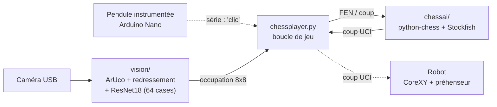

# Architecture logicielle

Retour au [README principal](../README.md)

*Traits pleins : implémenté. Pointillés : prévu.*

| Module | Rôle | Détail |
|---|---|---|
| `chessplayer.py` | Boucle de jeu | ci-dessous |
| `vision/` | Détection du plateau et du coup humain | [vision/README.md](../vision/README.md) |
| `chessai/` | État de la partie et Stockfish | [chessai/README.md](../chessai/README.md) |
| Robot (à écrire) | Coup UCI → trajectoire → G-code | ci-dessous et [electronique/README.md](../electronique/README.md) |
| `tools/onshape_export.py` | Export de la CAO Onshape | [mecanique/README.md](../mecanique/README.md#cao) |

## Boucle principale – `chessplayer.py`

Arguments :
- `--color blancs|noirs` : couleur jouée par la machine (noirs par défaut) ;
- `--debug-vision` : affiche les étapes de la vision ;
- `--test <image>` : teste la détection sur une photo, sans caméra.

Boucle tour par tour :
1. **Tour de la machine** : Stockfish propose un coup, affiché par une flèche dans la fenêtre Tkinter. Tant que le robot n'est pas opérationnel, l'humain joue ce coup à sa place.
2. **Tour humain** : l'humain joue sur le plateau physique.
3. **Validation** au clavier (`a` pour abandonner). À terme, ce sera l'appui sur la pendule, lu sur le port série (`wait_for_click`, présent mais commenté).
4. **Détection** : photo du plateau, occupation des 64 cases, puis déduction du coup par comparaison avec la position précédente, et mise à jour de la partie.

## Module robot – à écrire
Il reçoit un coup UCI et produit du G-code pour Marlin :
- conversion des cases en millimètres ;
- trajectoire qui évite les autres pièces (voir le [risque R-02](risques.md)) ;
- traitement du roque et des prises (rangement : [décision 010](decisions/010-rangement-des-pieces-prises.md)) ;
- commande du préhenseur ;
- envoi sur le port série en attendant `ok` après chaque commande.

Architecture cible : [décision 006](decisions/006-firmware-marlin-et-hote-gcode.md).
